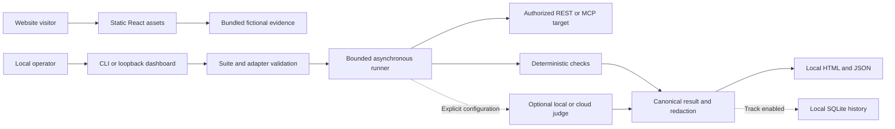

# Architecture

## Current system

The public React frontend and the Python execution engine ship from one repository but
have different runtime boundaries. The website serves static files. CLI/dashboard/MCP
execution, local SQLite history and generated reports stay in the user's environment.

There is no website-to-engine execution endpoint. Visiting the website does not start
an audit, send a conversation to a model, or write a customer response to a hosted store.

## Backend structure

| Component | Responsibility and design reason |
|---|---|
| `schema.py` | Shared validated contracts; reports, simulators and adapters agree on result shape |
| `config.py` | Typed environment boundary; provider/model/price/timeouts are maintained centrally |
| `packs/loader.py` | Safe YAML loading, schema/ID validation and honest draft-release checks |
| `targets/` | REST/MCP lifecycle and response metadata behind one target interface |
| `runner.py`, `evaluators/` | Bounded case execution and deterministic evidence |
| `judges/` | Optional semantic scoring; local mode and explicit cloud spend gate |
| `report/`, `baseline.py` | Redacted output and comparison of canonical artifacts |
| `experience/` | Optional local history; no implicit hosted synchronization |
| `simulator/`, `calibration.py` | Multi-turn fictional personas and judge/human comparison |
| `experience/generator.py`, `law.py` | Draft generation and informational mappings behind entitlement checks |
| `entitlements/` | Offline Ed25519 verification and shared feature checks |
| `dashboard/`, `mcp/server.py` | Thin surfaces that reuse the engine and entitlement rules |
| `billing/` | Isolated test-mode lifecycle; disabled by default and never publicly hosted |

The MCP target owns its session lifecycle in a dedicated worker and serializes calls;
this avoids sharing task-affine SDK contexts across runner tasks. The LangGraph example
reuses the simulator contracts rather than introducing a second audit engine.

## Frontend structure

`web/src/App.tsx` shares navigation, evidence exploration, setup dialogs and page shells.
`PageSections.tsx` supplies page-specific sections. `data/site.json` and `data/pages.json`
own maintained content; Zod validates that content. `config.ts` owns public link and
animation configuration. Vite emits direct HTML entries with unique metadata for each
page. Fonts, artwork and the fictional evidence are bundled locally.

Motion handles reveals and transitions; Lenis handles scrolling. A reactive system
media preference stops video and spatial/continuous motion. The muted looping hero
starts automatically when permitted, with a poster fallback. No motion toggle or media
playback button is present. Existing `/evidence/` and JSON URLs remain available.

## Trust boundaries and ownership

The operator owns target authorization, synthetic suites, target credentials and
report retention. Optional remote judging changes the egress boundary only by explicit
configuration. Public documentation and package data contain no private signing seed,
provider key, customer artifact or separately licensed content.

The local dashboard has no account system or tenant isolation. Its local trust model
must not be reused as the authentication design for a hosted service. Likewise, SQLite
history is not a shared database architecture for millions of users.

## Configuration ownership

Runtime secrets belong in the ignored environment or an approved secret store. Python
settings live in `config.py`; adapter behavior lives in validated suite YAML. Public
frontend overrides live in `web/.env.example`/`config.ts`. Product copy and planned prices
live in frontend data files. Protocol syntax remains in its owning adapter module.
The [configuration reference](configuration.md) inventories these boundaries.

## Expansion decisions

Future hosted components require a separate control plane, authenticated tenant
boundaries, job scheduling and dedicated data policies. Keeping the audit data plane
in customer-controlled environments is the preferred privacy-preserving path. See
[scalability](scalability.md) for the target design and [roadmap](roadmap.md) for its gates.
