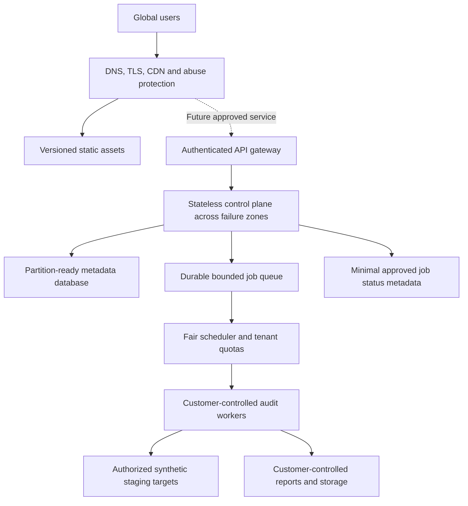

# Scalability architecture: 1M+ concurrent users

Status: **future engineering target**. This document defines how capacity would be
designed and verified; the present deployment has not been tested at this scale.
No infrastructure provisioning or hosted execution is activated by this design.

## Define the workload before selecting infrastructure

One million concurrent visitors, one million authenticated sessions, and one million
simultaneous audit jobs are different workloads. Report these separately. Size the
public site first, then any approved control plane, then customer-controlled execution.

| Planning scenario | Explicit assumption | Derived load |
|---|---|---|
| Public website | 1,000,000 active visitors request a page every 60 seconds | About 16,667 page requests/second, before assets |
| Cold asset delivery | Each page view transfers 2 MB of uncached assets | About 33.3 GB/second, or 267 Gbps; CDN delivery required |
| Control plane | Each of 1,000,000 active sessions makes 2 requests/minute | About 33,333 API requests/second |
| Job admission | 1% of those sessions submits one audit/minute | About 167 job submissions/second |
| Audit execution | Each admitted job makes 25 target requests over 60 seconds | About 4,167 target requests/second and 10,000 jobs in flight |

These are planning examples, not traffic measurements or commercial commitments.
The 2 MB transfer assumption is illustrative and must be replaced with measured cold/warm
asset budgets; video downloads can be substantially larger. Job duration, retry rates,
case count and judge latency must be measured for each workload. Using Little's Law,
in-flight work is approximately arrival rate multiplied by mean time in the system.

## Target topology



The future control plane coordinates execution; it must not silently receive customer
responses. Account metadata is personal data even when all audit inputs are fictional.
Any hosted identity/storage/billing feature requires the [legal entry gates](legal.md).

## Frontend and edge capacity

Serve immutable hashed JS/CSS/fonts/media from a CDN with long-lived asset caching;
keep HTML revalidation short enough to support rollouts. Record cache eligibility,
hit ratio, object size and purge behavior rather than assuming every extension is
cached. Preserve routes and fallback pages. Test a cold cache and an origin outage.

Use appropriately sized artwork, selective video loading and explicit transfer budgets.
Do not route static requests through audit workers. Protect origins from direct abuse,
retain restrictive security headers, and deploy versioned assets so a rollback does
not mix incompatible HTML and scripts.

## Control plane and scheduling

After scope approval, use stateless API replicas behind regional routing; define
idempotent job admission and tenant/object authorization on every operation. Return
an accepted job ID rather than waiting on an LLM request in an interactive HTTP handler.
Use bounded queues, per-tenant quotas, maximum job/case sizes, admission limits and
cancel/deadline semantics. Separate interactive status requests from long-running work.

Retry only transient errors, with capped exponential backoff, jitter and a retry budget.
Use leases/heartbeats to recover orphaned work. Design for at-least-once queue delivery;
deduplicate state transitions and result publication. A retry must not double-charge a
customer or create conflicting artifacts. Poison jobs go to a separately monitored
dead-letter lane with a documented recovery process.

Scale on queue age, arrival rate and worker saturation as well as CPU/memory. Resource
requests, maximum replicas and cooldowns must be explicit. Kubernetes HPA is an option
once orchestration is justified; it is not a requirement for the current static site.
Regional failover must respect residency and must not duplicate active job execution.

## Data and isolation

Keep report bytes and target credentials in the customer data plane by default. If a
future optional artifact service is approved, separate object storage from metadata,
encrypt stored data, enforce tenant-scoped access, and use short-lived access grants.
Never use shared local filesystem paths or a single SQLite file as tenant isolation.

Introduce managed relational storage only with explicit authorization, schema ownership,
backup/restore evidence and a migration plan. Use bounded connection pools, indexed
access paths and cursor pagination. Partition based on measured tenant/time access
patterns; add read replicas when measured read pressure warrants them. Cache permissioned
metadata with tenant-aware keys, invalidation and strict lifetime rules.

## Provider and downstream budgets

Worker count alone does not determine throughput. Measure target requests/minute,
model tokens/minute, provider concurrency, failure rate and egress. Apply independent
limits per customer, target and provider. A saturated or unavailable model must produce
bounded backpressure rather than a retry storm. Retain a deterministic-only execution
lane and explicit user approval for any per-usage model spending.

Capacity formula for a measured service lane:

```text
required replicas = ceil(peak requests/second / measured safe requests/second per replica)
provisioned replicas = required replicas plus measured failure and burst headroom
worker slots = job arrivals/second × mean job duration/second
target calls/second = jobs/second × cases/job × attempts/case
storage/day = jobs/day × measured retained bytes/job × retention multiplier
```

Safe throughput is established at the chosen latency/error thresholds with one failure
domain unavailable; it is not a hardware vendor's theoretical maximum.

## Verification ladder

| Stage | Test scope | Exit evidence |
|---|---|---|
| Baseline | One replica/worker, representative payloads, warm and cold cache | Throughput/latency/resource curves and bottleneck analysis |
| 1k sessions | Mixed browse/status traffic; concurrent tenant boundaries | Stable queues, bounded pools, no cross-tenant access |
| 10k sessions | Spike and sustained tests; slow providers and retries | Admission limits work; no unbounded growth |
| 100k sessions | Distributed generators, rolling deploy and lost worker/zone | Capacity and recovery targets met with failure headroom |
| 1M+ sessions | Approved distributed multi-region workload and realistic asset mix | Measured objectives met, generator capacity proven, costs bounded |

Proposed acceptance gates for an approved hosted control plane: API p95 ≤ 300 ms and
p99 ≤ 1 second for metadata operations, admitted-job acknowledgment p95 ≤ 1 second, and
server-error ratio ≤ 0.5% under the agreed normal workload. Report job completion latency
separately by case count/model/target. The initial endurance gate is 2 hours, followed by
a 24-hour soak before a scale milestone is considered validated. These are proposed
test thresholds, not measured service results.

Use k6 or equivalent load generation with named journeys, separate open-arrival and
closed-session models, pass/fail thresholds and archived scripts/results. Never direct
a large load test at shared production infrastructure, third-party targets or paid APIs
without explicit authorization and a costed plan. Verify the generators are not the
bottleneck. Small localhost checks do not prove the 1M milestone.

## Cost and operational readiness

Budget using measured request volume, egress, storage/retention, queue operations,
database I/O, model tokens, observability and redundancy. Obtain current provider quotes
at implementation time; no fixed dollar forecast is asserted here. Record cost per
1,000 page views, admitted job and completed audit, plus worst-case retry/abuse exposure.
Capacity increases require spending caps, operational owners and rollback criteria.

See [reliability](reliability.md), [security](security.md), [operations](operations.md)
and [roadmap](roadmap.md). Sources: [Cloudflare cache behavior](https://developers.cloudflare.com/cache/concepts/default-cache-behavior/),
[Kubernetes HPA](https://kubernetes.io/docs/concepts/workloads/autoscaling/horizontal-pod-autoscale/),
[k6 large tests](https://grafana.com/docs/k6/latest/testing-guides/running-large-tests/).
